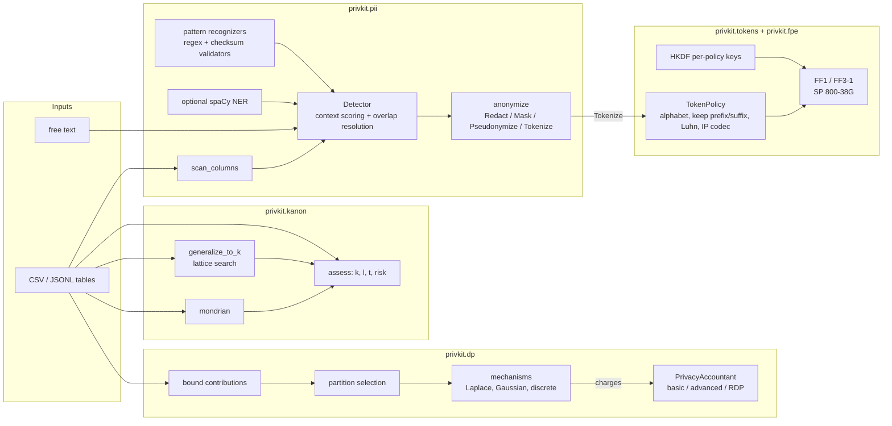

# privkit

A privacy toolkit for data pipelines, in Python. It covers four jobs that usually
need four separate tools:

| Job | What privkit does | Reversible? |
|---|---|---|
| **Find PII** | Regex candidates confirmed by checksum validators (Luhn, IBAN mod-97, Verhoeff, ABA, NHS mod-11, SSA rules) and scored by sentence-scoped context words. Optional spaCy NER adds PERSON / LOCATION. Column-level scanning for CSV / JSONL. | n/a |
| **Tokenize** | Vaultless format-preserving tokens with **NIST SP 800-38G FF1 and FF3-1**, implemented from the standard and checked against NIST vectors. Per-field keys via HKDF, Luhn-aware card tokens, IP-address codec, tagged tokens for free text. | yes, with the key |
| **Measure re-identification risk** | k-anonymity, distinct/entropy l-diversity, t-closeness, prosecutor risk; anonymize with minimum-loss full-domain generalization or Mondrian. | no |
| **Release aggregates with differential privacy** | Laplace / Gaussian mechanisms (exact discrete samplers for integer queries, analytic Gaussian calibration), bounded user contributions, private partition selection, and a privacy-budget accountant with basic / advanced / RDP composition and a persistent JSON ledger. | no |

It ships as a typed library (`import privkit`) and a CLI (`privkit ...`).

**Who it is for:** data and platform engineers who need to strip or tokenize PII before
data leaves a trusted zone, analysts who must publish aggregates over user data, and
anyone who wants to read compact, tested reference implementations of FF1/FF3-1,
the Canonne-Kamath-Steinke discrete samplers, or Mondrian.

**What it is not:** a hosted service, a key-management system, or a guarantee that all
PII in arbitrary text is found. See [Limitations](#limitations) and
[docs/THREAT_MODEL.md](docs/THREAT_MODEL.md).

## Architecture



Deeper design notes, algorithms and complexity: [docs/ARCHITECTURE.md](docs/ARCHITECTURE.md).

## Quickstart

Requires Python 3.12 and [uv](https://docs.astral.sh/uv/).

```bash
uv sync                      # install runtime + dev dependencies from uv.lock
make check                   # format check, lint, mypy --strict, tests + coverage gate
make demo                    # offline end-to-end demo on bundled synthetic fixtures
make ner-model               # optional: spaCy extra + en_core_web_sm (needs network)
```

### CLI

```bash
export PRIVKIT_KEY=$(uv run privkit keygen)        # 256-bit master key, hex

uv run privkit scan tickets.txt --fail-on-findings  # exit 3 if any PII is found (CI gate)
uv run privkit redact tickets.txt --mode tokenize --tagged -o tickets.tok.txt
uv run privkit detokenize tickets.tok.txt
uv run privkit scan-table customers.csv
uv run privkit tokenize-table customers.csv --columns card_number=CREDIT_CARD,ssn=US_SSN -o tok.csv
uv run privkit kanon customers.csv --qi age,zip,sex --sensitive diagnosis -k 5 \
    --generalize age=interval:5,10,20 --generalize zip=mask:3 --max-suppression 0.02 -o k5.csv
uv run privkit budget init ledger.json --epsilon 1 --delta 1e-5 --composition rdp
uv run privkit dp transactions.csv --metric mean --privacy-unit user_id --group-by region \
    --value amount --lower 0 --upper 200 --epsilon 0.4 --public-partitions north,south,east,west \
    --ledger ledger.json
```

Exit codes: `0` ok, `2` usage / configuration / input error, `3` findings present
(`scan --fail-on-findings`), `4` privacy budget exceeded.

### Library

```python
from privkit import Detector, Tokenizer, anonymize, PrivacyAccountant, DPAggregator
from privkit.pii import Tokenize
from privkit.keys import key_from_env

text = "Card 4111 1111 1111 1111, ssn 123-45-6789, mail ann.lee@example.com"
findings = Detector().analyze(text)  # [Finding(entity='CREDIT_CARD', ...), ...]

tok = Tokenizer(key_from_env())  # PRIVKIT_KEY
safe = anonymize(text, findings, default=Tokenize(tok, tagged=True)).text
# 'Card [[CREDIT_CARD:7663 7791 0784 1111]], ssn [[US_SSN:073-06-9693]], mail [[EMAIL:RWr.Uec@example.com]]'
# (token digits depend on the key; the last four card digits and the email domain are kept)

acct = PrivacyAccountant(epsilon=1.0, delta=1e-5, composition="rdp")
agg = DPAggregator(acct)  # OS CSPRNG by default
records = [("user-1", "north", 12.5), ("user-2", "south", 40.0)]  # (privacy unit, group, value)
res = agg.mean(records, lower=0, upper=200, epsilon=0.4, public_partitions=["north", "south"])
print(res.to_rows(), acct.remaining())
```

## Demo output

Excerpt of a real `make demo` run (full script: [scripts/demo.sh](scripts/demo.sh); all data is
synthetic and the key is a fixed demo key):

```text
== 2. Reversible tokenization of free text, then exact round trip
$ privkit redact examples/fixtures/support_tickets.txt --mode tokenize --tagged -o out/demo/tickets.tokenized.txt
You can reach me at [[EMAIL:DIs2O_MjIU2b@inbox.example.io]] or on my mobile [[PHONE:+62 3 3588 0858]]. Nina Wilson moved from Paris and was born [[DATE_OF_BIRTH:UY NM9lie5fJ vWPU]]. Host [[IP_ADDRESS:1303:3798:2ca2:28da:dd31:514:7a5c:b]] answered the health check.
$ privkit detokenize out/demo/tickets.tokenized.txt -o out/demo/tickets.restored.txt
round trip: restored text is byte-identical

== 4. Find PII columns in a table
$ privkit scan-table examples/fixtures/customers.csv --sample 500
column               pii             prevalence  header-hint
customer_id          -                       0%  -
name                 -                       0%  PERSON
email                EMAIL                 100%  EMAIL
phone                PHONE                 100%  PHONE
card_number          CREDIT_CARD           100%  CREDIT_CARD
ssn                  US_SSN                100%  US_SSN
...

== 5. Format-preserving tokenization of columns (FF1, per-column keys)
original : C00000,Olivia Brown,olivia.brown899@example.com,768.427.6794,3710 602482 24151,694-75-0547,50,02140,M,north,flu
tokenized: C00000,Olivia Brown,VpM2ir.JorrbCt2@example.com,542.762.9651,9518 941548 44151,374-30-6415,50,02140,M,north,flu
round trip: 2000 rows restored byte-identically

== 6. NIST SP 800-38G FF1 sample #1 (key 2B7E...4F3C, radix 10, empty tweak)
ciphertext: 2433477484
expected  : 2433477484

== 7b. Full-domain generalization to k=5 (<=2% suppression)
before: k=1 (target 5, VIOLATED) classes=1274 at-risk=1954/2000 unique=773 max-risk=1.000
        diagnosis: distinct-l=1 entropy-l=1.0 t=0.847
 after: k=6 (target 5, OK) classes=49 at-risk=0/1973 unique=0 max-risk=0.167
        diagnosis: distinct-l=4 entropy-l=3.7798 t=0.3909
generalization: {"levels": {"age": 1, "zip": 1, "sex": 0}, "suppressed": 27, "precision_loss": 0.1667, "nodes_checked": 5, "n_output_rows": 1973}

== 8. Differentially private aggregates under a shared budget (eps=1.0, delta=1e-5, RDP)
$ privkit dp examples/fixtures/transactions.csv --metric count --privacy-unit user_id --group-by region --epsilon 0.3 --delta 1e-6 --max-partitions 2 --ledger out/demo/ledger.json --label users_per_region --insecure-seed 7
privkit: WARNING: seeded RNG in use: DP noise is reproducible and the output is NOT private
partition                     value       ±95%
east                         992.00      30.00
north                        981.00      30.00
south                       1051.00      30.00
west                        1035.00      30.00
query cost eps=0.3 delta=1e-06; budget spent eps=0.3/1 delta=1e-06/1e-05
...
== 8b. A query that would overspend the budget is refused (exit code 4)
privkit: budget exceeded: release would raise spending to (eps=1.2, delta=1e-06) over the budget (eps=1, delta=1e-05)
exit code: 4
```

`--insecure-seed` exists only so the demo output is reproducible; it prints the warning shown.

## Design decisions (short version)

Full list with rationale and cost-if-wrong: [DECISIONS.md](DECISIONS.md).

- **FPE implemented from SP 800-38G, not wrapped.** About 200 lines for FF1 + FF3-1 on top of
  `cryptography`'s AES block primitive, verified against all 1,200 ACVP vectors. Only FF3-1
  is offered; the original FF3 (64-bit tweak) is broken.
- **Vaultless tokens.** Tokens are a keyed permutation, so there is no token database to protect,
  replicate or breach. The price: tokens are deterministic (equality leaks), and key rotation
  means re-tokenizing.
- **Domains under one million values are refused**, as SP 800-38G Rev. 1 requires. Short
  values fall back to redaction in text mode rather than producing a weak token.
- **Detector: validate, then score context.** Regexes only propose candidates. A checksum or
  structural validator must accept them, and context words (scoped to the sentence, and
  "consumed" by an intervening number) push weak patterns such as bare 9-digit numbers over
  the threshold. Findings never print their value in `repr()` or logs.
- **DP: integer queries use exact discrete samplers** (no floating-point side channel);
  real-valued sums use the continuous Laplace / analytic Gaussian with that caveat documented.
- **The accountant charges before it releases.** A refused query produces no noisy value and
  leaves no partial ledger entry. Multi-part queries (mean = count + sum, plus partition
  selection) are charged atomically.

## Evaluation and benchmarks

Every number below comes from the command shown next to it.

### FPE correctness: NIST vectors

```bash
uv run pytest tests/unit/test_fpe_vectors.py
# 1210 passed
```

That covers the 9 classic SP 800-38G FF1 samples, all 750 ACVP-AES-FF1 cases and all 450
ACVP-AES-FF3-1 cases (AES-128/192/256, radix 2-64, encrypt and decrypt), plus a count check.
Vector provenance is in [DATA.md](DATA.md).

### DP mechanisms: noise has the distribution the proof assumes

`tests/unit/test_dp_distributions.py` runs chi-square goodness-of-fit tests of the exact
discrete Laplace and discrete Gaussian samplers against their exact pmfs, Kolmogorov-Smirnov
tests of the continuous Laplace and Gaussian noise, binomial tests of the exact
Bernoulli(exp(-γ)) sampler, 95% interval coverage, and an empirical check that output
frequencies on neighbouring inputs differ by at most e^ε. The goodness-of-fit tests draw
20,000 samples each at significance α = 1e-3, all with fixed seeds:

```bash
uv run pytest tests/unit/test_dp_distributions.py
# 26 passed
```

`tests/unit/test_dp_mechanisms.py` checks that the analytic Gaussian calibration is tight
(1% less noise breaks the δ bound) and reproduces the Balle & Wang value σ ≈ 3.73 at ε = 1,
δ = 1e-5.

### PII detector: precision / recall on a held-out synthetic corpus

```bash
make eval        # = uv run python -u scripts/eval_detector.py  (2,000 docs per split, seed 2026)
```

Held-out **test** split. Templates, context phrasing and name/city pools are disjoint from
the dev split used for tuning. Matching is strict: entity type and exact character span.

| entity | precision | recall | F1 | support |
|---|---:|---:|---:|---:|
| CREDIT_CARD | 0.998 | 1.000 | 0.999 | 464 |
| DATE_OF_BIRTH | 1.000 | 1.000 | 1.000 | 292 |
| EMAIL | 1.000 | 1.000 | 1.000 | 625 |
| IBAN | 1.000 | 1.000 | 1.000 | 295 |
| IN_AADHAAR | 1.000 | 1.000 | 1.000 | 135 |
| IP_ADDRESS | 1.000 | 1.000 | 1.000 | 648 |
| MAC_ADDRESS | 1.000 | 1.000 | 1.000 | 135 |
| PHONE | 1.000 | 1.000 | 1.000 | 441 |
| UK_NHS | 1.000 | 1.000 | 1.000 | 134 |
| US_ABA_ROUTING | 1.000 | 1.000 | 1.000 | 170 |
| US_SSN | 1.000 | 1.000 | 1.000 | 442 |
| **micro (regex + checksum)** | **1.000** | **1.000** | **1.000** | 3781 |

With the optional spaCy model (`make ner-model && make eval`), same test split:

| entity | precision | recall | F1 | support |
|---|---:|---:|---:|---:|
| PERSON | 0.610 | 0.627 | 0.618 | 927 |
| LOCATION | 0.974 | 0.967 | 0.971 | 552 |
| **micro (all 13 types)** | **0.927** | **0.931** | **0.929** | 5260 |

**Read these numbers with care.** The corpus is synthetic and its generator was written by
the same author as the recognizers. Identifiers are valid by construction, and the hard
negatives are the kinds of confusions the recognizers were designed for. Near-perfect regex
scores here mean "the recognizers do what they were designed to do on held-out phrasings".
They do not mean "finds all PII in your data". The single held-out credit-card false positive
is real: the digits of a checksum-invalid IBAN happened to form a Luhn-valid Diners number.
NER PERSON recall falls from 0.88 (dev) to 0.63 (test), which is a fair picture of what a
small general-purpose NER model does on unfamiliar sentence shapes. Full per-split JSON
output: `eval/results.json`.

### Coverage

```bash
make cov          # pytest --cov --cov-fail-under=90
# TOTAL ... 99%   (1453 passed, 1 skipped: the spaCy test when the model is absent)
```

### Benchmarks

`make bench` (single thread; Apple-silicon laptop shared with other jobs, so treat these as
rough orders of magnitude; output also in `eval/bench.json`):

| benchmark | throughput |
|---|---:|
| FF1 encrypt, 16 digits | 27,331 ops/s |
| FF3-1 encrypt, 16 digits | 49,782 ops/s |
| tokenize CREDIT_CARD (keep last 4) | 23,671 ops/s |
| detector analyze (regex + checksum) | 1,829,059 chars/s |
| exact discrete Laplace sample (scale 10) | 53,997 samples/s |
| exact discrete Gaussian sample (σ² = 25) | 25,847 samples/s |
| DP mean with private partition selection | 659,302 records/s |
| Mondrian k = 10, 3 QIs, 10k rows | 168,413 rows/s |
| full-domain generalization k = 10, 10k rows | 168,037 rows/s |

FF3-1 is faster than FF1 because it makes 8 rounds of one AES call each; FF1 makes 10 rounds
of CBC-MAC.

### Size

```bash
make loc
# non-test source lines (src/privkit, excluding blanks and comments): 3896
```

## Limitations

- **Detection is pattern-based.** Free-form PII (addresses, names without NER, account
  numbers without checksums, PII in images or PDFs) is out of scope, and so is anything
  obfuscated or split across lines. US/UK/IN/EU identifiers only. Context words are English.
- **The evaluation corpus is synthetic and self-authored** (see above). No real-world labeled
  dataset was used, so real-world recall is unmeasured.
- **NER is optional and weak on PERSON**: spaCy `en_core_web_sm` gives a fixed score and
  scored F1 0.62 on held-out sentence shapes.
- **Tokens are deterministic.** Equal inputs map to equal tokens under one key and policy.
  That keeps joins working, and it also enables frequency analysis on low-entropy columns.
  Tokenization is pseudonymization, not anonymization (GDPR Recital 26).
- **No key management.** The master key comes from an environment variable. Rotation means
  detokenizing and re-tokenizing. There is no HSM or KMS integration.
- **Continuous DP mechanisms use floating point.** The Laplace and Gaussian samplers for
  real-valued sums are open to Mironov-style floating-point attacks in principle. Integer
  queries avoid this through the exact discrete samplers. No snapping mechanism is
  implemented.
- **The accountant's advanced and RDP bounds assume non-adaptive parameter choice.** Basic
  composition is always valid as a budget filter. See
  [docs/DP_GUARANTEES.md](docs/DP_GUARANTEES.md).
- **The ledger file is not tamper-proof or multi-writer safe.** Saves are atomic, but two
  processes sharing one ledger can race.
- **k-anonymity search is exhaustive over the hierarchy lattice**, which costs
  O(n · Π(hᵢ+1)). That is fine for a handful of QIs and short hierarchies, slow for many.
  Mondrian supports numeric and lexicographically ordered categorical QIs, without
  taxonomies.
- **Pure Python.** It is fast enough for batch jobs of millions of cells, not for
  high-throughput streaming.
- **CI is configured but has not run.** `.github/workflows/ci.yml` runs the same gates. It
  has not executed because the repository has not been pushed.

## Roadmap

- Snapping mechanism (Mironov 2012) for real-valued Laplace releases.
- Privacy filters (Feldman & Zrnic 2021) so RDP accounting stays valid under adaptive queries.
- KMS-backed key provider interface and key-version prefixes in tokens to support rotation.
- Locale packs: more national identifiers and non-English context words.
- Evaluation on a public labeled PII corpus with a compatible license.
- Streaming / chunked table scanning for files larger than memory.

## License

MIT. See [LICENSE](LICENSE).
